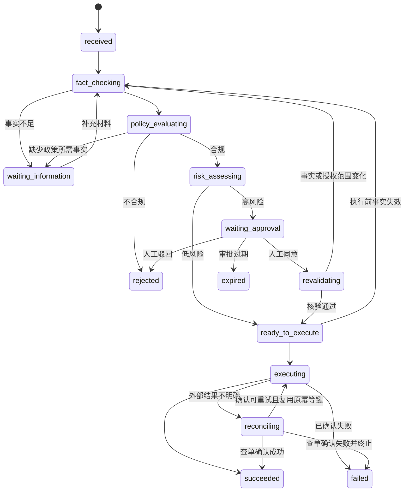

# 架构约束与实施边界

## 模块职责

| 模块 | 负责 | 执行边界 |
| --- | --- | --- |
| supervisor | 识别意图、澄清歧义、拆分复合任务 | 不决定是否有权退款 |
| presales | SKU、库存、优惠与发货时效查询 | 不写资金流水 |
| logistics | 查询物流、判断异常、申请改址 | 改址与仓库出库共享履约门禁 |
| aftersales | 可信事实核验、政策裁决、风险评估 | 不直接调用支付 API |
| approvals | 审批工单、审批权限、挂起与唤醒 | 通过后必须重新核验 |
| payments | 幂等资金动作、额度预占、支付查单与对账 | 仅内部受控调用 |

模块内后续按需增加 `models.py`、`schemas.py`、`service.py`、`repository.py`。已增加独立 HTTP 模型网关，尚未引入 Agent 或工作流框架；模型接入后仍受领域规则约束。

## 客服会话入口

入口接待先用普通程序推荐和确认订单，流程图与接口契约见 [客服接待流程](flows/customer-reception.md)。
接待会话独立于售后工作流：绑定订单不代表有权退款或修改地址。当前提供后端接口和认证接入边界，
已提供 Vue 3 + TypeScript 接待页面及订单状态建议问题；已实现自由输入意图识别、独立 Outbox 消费者、只读工具和持久化回复；登录尚未实现。

前端组件、会话状态与开发/构建方式见 [前端指南](frontend.md)。

## 核心流程

`domain/workflow.py` 当前只约束状态图拓扑，不提供业务授权、持久化、事务或 Worker。任何状态变化的真实落库必须使用数据库 CAS 或行锁并同时写审计。

## 必须由后端保证的规则

1. 金额使用整数分；时间使用带时区的 UTC；租户和用户身份来自认证上下文。
2. 用户文本、OCR、物流备注和模型输出均是不可信输入；模型不持有支付凭据。
3. 事实不足不能推断合规；政策合规与风险评级分开计算。
4. 已知风险条件：本次退款金额严格大于 20000 分，或历史退货率严格大于 30%。退货率缺失或过期不能默认低风险；累计金额防拆分规则后续单独版本化。
5. 高风险必须先在同一事务中保存检查点、审批单、审计和 Outbox，再结束执行。
6. 审批权限必须认证，审批范围绑定租户、订单、动作、金额、币种和裁决版本。聊天文本不能批准退款。
7. 恢复时重新核验审批与事实；变化超出授权范围时重新评估或审批。
8. 资金工具独立检查授权、余额和幂等性；相同幂等键不同请求参数必须拒绝。
9. 每笔人工批准的退款申请使用稳定的 `case:<case_id>:REFUND` 幂等键。不同申请可以分别执行，并在订单行锁内预留共享余额，防止并发超退。
10. 支付超时先查单和对账，不生成新键盲目重试；用户通知失败只重试通知。
11. Redis 不承担审批真相源或资金一致性保障；业务状态和 Outbox 以 PostgreSQL 为准。

## 待确认业务项

- 每单一次全额退款，还是按商品多次部分退款。
- 哪些退款必须先退货入库。
- 历史退货率的时间窗口与统计口径。
- 生鲜异常理赔是否无条件需要人工特批。

## 实施顺序

1. 业务表、数据库约束与初始迁移；认证和租户上下文。
2. 可信查询工具、版本化政策与确定性风控。
3. 持久化工作流、审批接口、Outbox/Inbox 与恢复 Worker。
4. 受控支付适配、原子额度预占、幂等、查单与对账。
5. 模型路由、凭证辅助审核、运营后台、限流及监控。

核心数据表与真实 PostgreSQL 并发、事务回滚测试已落地，字段定义见 [数据模型](data-model.md)。正式上线前仍需服务级故障恢复测试和支付沙箱测试。依赖锁定、镜像摘要、凭据托管、备份恢复、可观测性和容量压测尚未纳入当前骨架。

## 当前客服 Agent

不引入新的 Agent 框架，使用显式 Python 编排。`intent.py` 定义模型输出词表和校验；
`agent_worker.py` 管理领取、租约、恢复与原子提交；`read_tools.py` 执行限定租户与用户的查询。
小模型只输出会话动作、业务意图和订单指向；大模型通过 `conversation_agent.py` 输出受限 JSON 动作，负责查询、破损提取及自然回复。后端校验工具参数与身份，不接受任意 SQL 或退款授权。
具体运行与失败语义见 [客服 Agent](customer-agent.md)。此 Worker 不是售后审批工作流。

## 多轮破损信息收集

在既有 Python 编排中增加 `aftersales/damage_extraction.py`（原文主张结构及引用校验）、
`damage_collection.py`（商品归属、数量上限、缺项推导与草稿持久化）。不引入新 Agent 框架。
该阶段只改变信息草稿，不创建需要申请金额的正式售后单；附件已接收和有效凭证分开记录。
完整设计与后续边界见 [多商品破损申报](damage-collection.md)。
