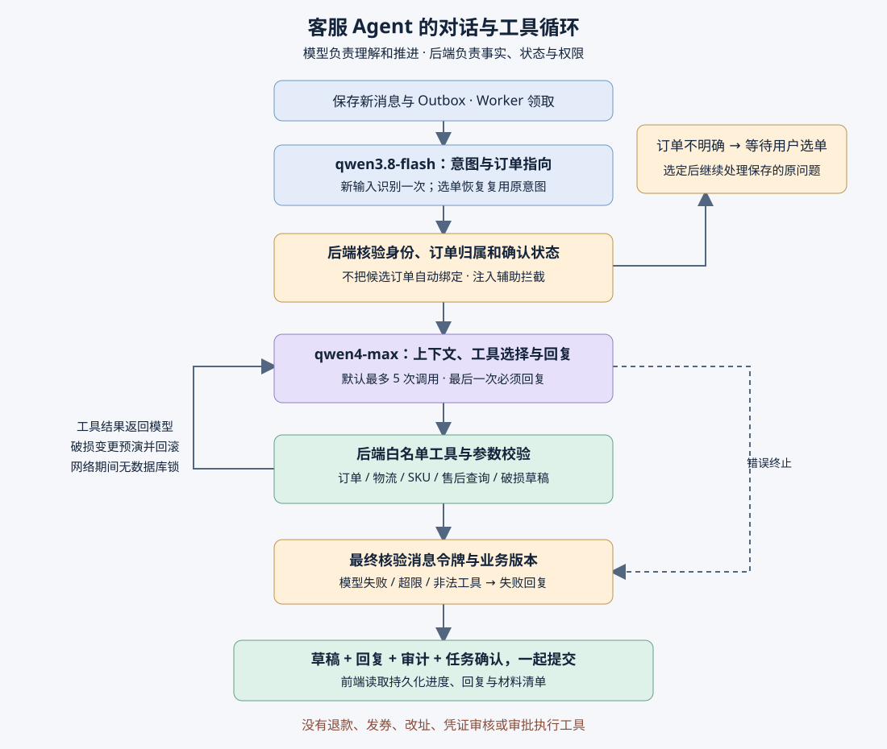
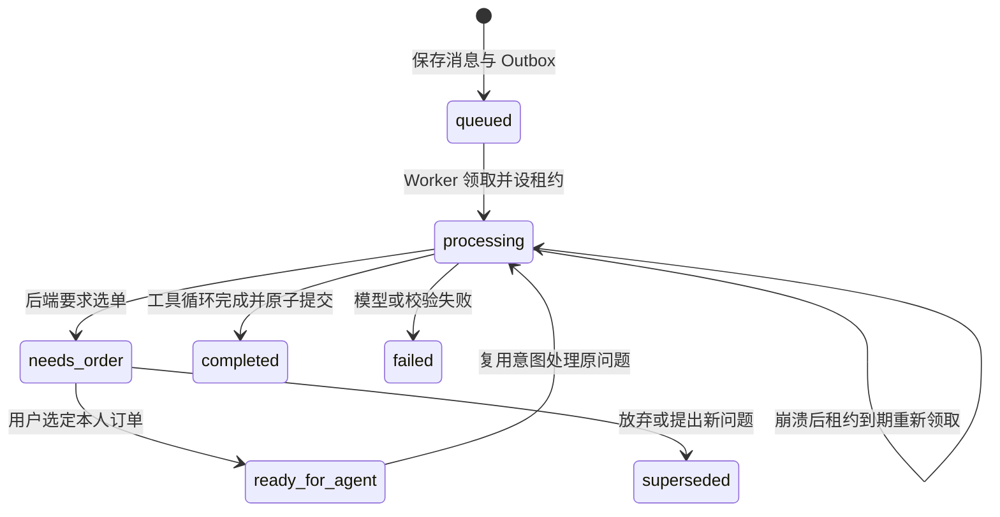

# 客服 Agent：意图识别、工具循环与可信状态

## 大小模型分工

入口推荐、确认按钮和建议问题由普通后端规则完成。自由输入先由 `qwen3.8-flash`
输出严格意图 JSON：会话动作、1～4 个业务诉求、订单指向、歧义与疑似注入标记。
明确订单号必须出现在本轮原文中，再按租户和用户核验；候选订单不自动绑定。

通过订单定位后，`qwen4-max` 负责理解上下文、选择工具、提取本轮破损陈述、追问和自然回复。
上下文包括最多四轮已完成的问题及回复；其他已绑定订单的历史不传入。
小模型每条新自由输入调用一次，选单恢复复用保存的意图。任务已明确后的对话仍经小模型
识别切单及新话题，但大小模型分工独立：分类结果不是业务授权，大模型也可以补充查询。



## 受限工具循环

使用显式 Python 编排，不依赖 LangChain/LangGraph。网关保持文本兼容接口；
`conversation_agent.py` 校验模型输出的 JSON 动作，再由 Worker 分派工具。
这不是供应商原生 `tool_calls`，也不执行模型生成的代码、SQL 或任意 URL。

| 动作 | 内容及边界 |
| --- | --- |
| `query_order` | 后端确定的当前订单基础事实 |
| `query_logistics` | 最多 10 个包裹、各最近 5 条事件，以及同一订单的最近一条人工查件进度 |
| `query_sku` | 当前入口 SKU 的规格、库存；优惠和时效数据未接入时明确说明 |
| `search_products` | 用用户原话中的关键词查当前店铺在售 SKU，最多返回 3 张可点击卡片 |
| `query_aftersales` | 当前订单已有售后单及本会话人工材料核验进度 |
| `inspect_damage` | 商品明细、已收集主张、待关联项、照片数量、缺项及人工结论 |
| `collect_damage` | 校验本轮原话和数量，预演草稿变化；每轮最多一次 |
| `reply` | 自然语言回复，结束本轮 |

工具参数没有用户或订单 ID，由后端固定授权范围。破损字段允许给定订单明细 ID，
仍需后端校验商品名称/焦点、数量上限及原话引用。破损必须先查看草稿再提交收集；
物流、库存、规格及售后查询类意图必须完成对应查询才能结束本轮。
默认每轮最多 5 次大模型调用（含最终回复），可配置 `NEXUSGUARD_AGENT_MAX_STEPS=2..8`。
重复工具、未知字段、越权工具、非法引用、缺少必需查询、超限及上游错误均结束本轮，
不自动重试模型或切换档位。复杂复合诉求超过预算时需要重新提问或调整预算。

## 状态和原子提交



Outbox 使用 `FOR UPDATE SKIP LOCKED` 领取，租约为
`(1 + AGENT_MAX_STEPS) × LLM_TIMEOUT_SECONDS + 60 秒`。
网络调用期间没有打开的数据库事务或行锁。每次工具调用重新校验身份、消息令牌、
会话及订单版本；最终提交再次核验。数据库快照只代表查询时刻，物流和库存可能随后变化。

`collect_damage` 在短事务中执行实际业务校验并回滚预演，将缺项返回模型。
最终在令牌有效的 Worker 中重新应用提取结果，将草稿、回复、审计、消息状态及 Inbox
确认一起提交；模型在预演后失败不会留下半份草稿。预演产生的内部随机 ID 不传给用户。
同会话处理中拒绝其他写操作；不同会话可并行。同消息 UUID 与同阶段回复保持去重。
进程中断可重新领取，累计最多三次；模型已响应但未提交的崩溃可能产生重复调用费用。

## 能力与限制

模型读取已保存的人工处理结果。后端负责申请提交、人工结论保存与会话通知。详见 [破损售后申请](damage-review.md)。

单纯找商品时，后端根据查询结果直接回复。找到就附卡片，没有结果就说明，商品名不明确时才问一句。回复历史只对外提供卡片字段，店铺的详情接口会重新检查商品是否在售。
工具隔离保证模型不能执行这些操作；自然语言仍可能有错误承诺，需要真实业务评估，
不能把提示词约束当成绝对的输出正确性保证。附件只确认接收，不表示有效凭证。
疑似注入标记是辅助信号，安全边界是后端身份、工具白名单和业务校验。
不向模型传输地址、支付凭据或图片。系统还需要宿主提供可信客户身份。

改址意图定位到本人订单后，由后端根据履约状态返回改址表单或拦截原因。单独的改址诉求只调用意图识别模型。顾客用独立表单提交地址，后端在事务里复核订单归属、状态和版本，再保存并写入不含地址正文的审计记录。

物流查询发现承运方标记异常，或包裹未签收且超过承诺送达时间时，后端在答复下提供「请人工查件」。顾客确认后，接口重查物流并保存异常包裹及轨迹快照，同一订单只保留一张待处理工单。工作人员在查件工作台办结后，Worker 将原文发布回顾客发起申请的会话。

## 启动和阅读顺序

```bash
source .venv/bin/activate
alembic upgrade head
python -m nexusguard.modules.supervisor.agent_worker
# 另一个终端
uvicorn nexusguard.main:create_app --factory --reload
```

容器可复用 API 镜像另起 Worker；Redis 不是此队列的真相源。
建议阅读：`intent.py → conversation_agent.py → agent_worker.py → damage_collection.py`。
整体回归见 `tests/integration/test_customer_journey.py`，通过 HTTP、真实 PostgreSQL、
真实网关解析和脚本化供应商响应覆盖完整链路，不需要外网或真实 Key。
