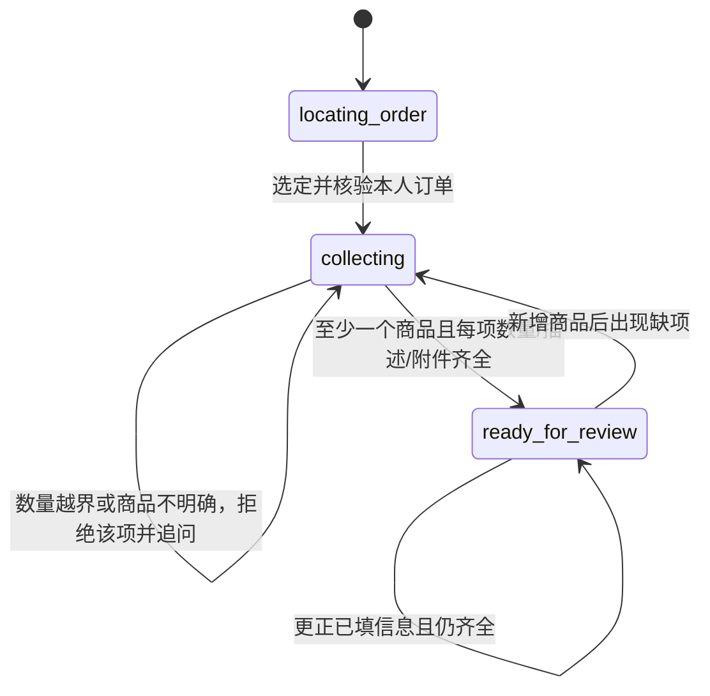

# 多商品破损申报：信息收集阶段

## 如何使用

先确认订单，输入“这单草莓和牛奶都有破损”。系统查询真实订单明细，建立申报草稿。
商品明确且名称唯一时可直接记录；同名多规格或指代不明时，在面板点击具体商品。
待关联的数量与原话描述最多保留 20 条，选择具体商品后直接关联，也可放弃误述；无需重复填写。
选择后可补充“一盒，发霉了”，也可明确说“牛奶两瓶漏液”。已填内容保留，后续只追问缺项。

每个商品分别展示购买数量、破损总数量、用户描述和照片数量。数量以订单购买单位为准，
不进行盒/颗/重量等单位换算；更正数量直接覆盖该商品的总数，不累加、不截断。
数量超过购买数时拒绝该商品本轮更新；不明确的描述不覆盖旧值。
每轮最多提取 4 个商品，可以分多轮补充。一个订单最多支持 200 个明细，超出时本轮明确失败。
可通过按钮移除商品；移除只是排除本次申报，原记录及附件仍保留，再次选择会恢复已填信息。

照片通过各商品的上传按钮发送真实文件，不能通过“我已经上传了”或模型生成的附件 ID 登记。
刷新后按会话与订单恢复草稿；切换订单时不会混用另一单的申报，切回原订单会显示原草稿。
同一会话、同一订单只有一份草稿；不同会话的草稿独立，后续正式建单还需单独去重。

## 模型、规则和状态分别负责什么

- 意图识别仍使用 `qwen3.8-flash`；有破损草稿时，数量/描述/照片状态补充可识别为破损诉求，其他话题照常处理。
- 随后由 `qwen4-max` 在工具循环中查看草稿、提取本轮原文中的商品指向、总数量和描述，并根据后端缺项自然追问。图片不发送给模型。
- 模型的引用必须逐字来自本轮文字，数量还经过保守的数字字面值校验。模糊指代只能绑定用户选中的商品。
- 后端验证明细属于该订单、名称指向唯一、数量不超过购买数量，再更新对应草稿项。
- 用户描述是未经核实的主张。商品、数量、描述和真实附件齐全，仅代表信息完整，不代表理赔合规。

[SVG 流程图](flows/damage-collection.svg) 可直接查看和复用。

## 持久化与事务

增量迁移 `0004_damage` 新增 `damage_drafts`、`damage_draft_items`、`damage_attachments`。
草稿独立于 `aftersales_cases`，避免材料未齐就伪造申请金额或生成正式理赔工单。
复合外键限定订单归属和明细关联，商品数量上限由服务检查；正文与用户描述不写审计日志。

后台模型调用在事务外进行，意图和提取结果通过校验后，与草稿更新、回复、审计和事件确认一起提交。
一轮新问题包含一次意图识别和最多 `AGENT_MAX_STEPS` 次大模型调用（默认 5 次）。任务租约为 `(1 + AGENT_MAX_STEPS) × LLM_TIMEOUT_SECONDS + 60 秒`。收集工具先校验并回滚预演，最终草稿与回复、审计一起提交；模型失败不保存半份草稿。
按钮/附件与聊天修改共用会话锁和 `expected_version`，处理中拒绝改动；中断后沿用已有任务恢复。

图片暂存 PostgreSQL `BYTEA`，接收时计算 SHA-256。单张最多 5 MiB，每份草稿最多 10 张、合计 20 MiB，
只接受 JPEG/PNG，检查 MIME 和文件头；这是基础格式检查，不是完整解码、恶意文件扫描或内容审核。
附件只允许 `pending`，不会自动升级为有效凭证。同一上传 UUID 不同内容/商品返回 409，
同商品重复内容按哈希去重。列表查询只读取附件元数据，不读取图片字节。
网络结果不明时，前端保留文件和上传 UUID，提供重试并暂停其他操作；这些待确认信息仅在本页内存保存。

当前文件保存方式适用于本项目的受限初版。正式上线仍需对象存储、访问控制下载、保留/删除策略、
容量和流量限制以及凭证审核流程；图片当前不对外提供下载或预览接口。

## 接口和运行

接口前缀 `/api/v1/supervisor/reception`，均要求可信用户身份：

| 接口 | 用途 |
| --- | --- |
| `GET /sessions/{id}` | 视图增加 `damage_draft`，包含明细、已填内容、真实附件元数据与缺项 |
| `POST /sessions/{id}/damage/{draft_id}/items` | JSON：`action=select/remove/discard_pending`、`expected_version`；选商品传 `order_item_id`，关联或放弃待确认信息传 `pending_claim_id` |
| `POST /sessions/{id}/damage/{draft_id}/items/{claim_id}/photos/{upload_id}?expected_version=N` | 请求体为原始 JPEG/PNG 字节，`Content-Type` 使用对应图片类型；无 multipart 或文件路径 |

`claim_id` 是草稿项 ID，不能用订单明细 ID 代替；上传 ID 由客户端生成稳定 UUID。
运行前执行 `alembic upgrade head`，启动现有 API 和 `python -m nexusguard.modules.supervisor.agent_worker`。
迁移需显式运行，应用启动时不会自动改表。整体回归范围与结果见 [验证记录](verification.md)。

当前不执行照片真实性核验、政策裁决、正式理赔建单、退款或人工审批。
接下来确定业务政策后，才能将 `ready_for_review` 草稿送入事实核验与政策判断。
