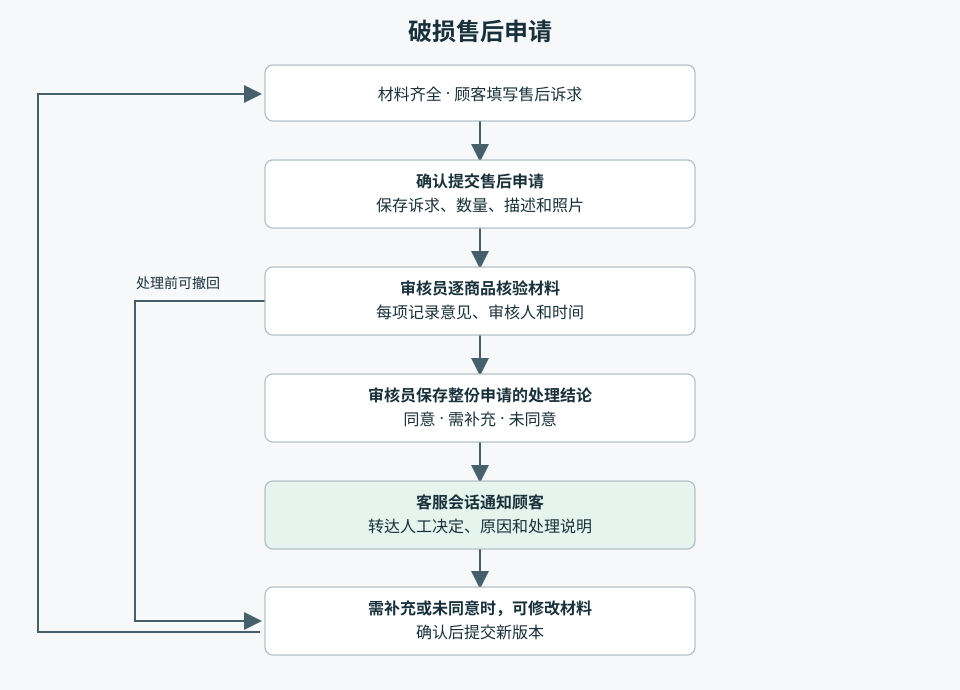

# 破损售后申请

顾客收齐破损数量、描述和照片后，在客服面板填写希望如何处理，点击「确认提交售后申请」。同一次提交保存诉求和材料快照，进入人工处理。主管在 `/damage-review` 记录逐商品核验意见，再决定整份申请的处理方式、原因和下一步。

| 申请状态 | 顾客或审核员可做的事 |
| --- | --- |
| 待核验材料 | 审核员查看各商品的数量、描述和照片，保存逐项结论。顾客可撤回修改 |
| 待人工处理 | 审核员查看逐项意见和订单实付，填写整份申请结论。顾客仍可撤回 |
| 已处理 | 顾客在会话里收到处理原因和说明。需补充或未同意时，可修改材料并提交新版本 |
| 已撤回 | 草稿及已有逐项意见保留。顾客可继续编辑并重新提交 |

例如，顾客申请退一盒压坏的苹果的钱。审核员先核验照片，然后选择「同意申请」并填写审核确认金额。客服会话显示人工结论和退款进度。如果审核员要求补拍包装，顾客可补传照片并重新提交，旧版本的材料和结论保留。

## 后端与 Agent 的分工

审核员在同一个工作台选择「同意申请」「需要补充」或「未同意申请」。后端在会话锁内保存结论、原因、处理说明、审核员和时间。若填写退款金额，后端校验该金额为正且不超过订单实付。锁同样保护顾客的撤回与重提，重复提交同一结论只保留一份。

整份申请完成后，同一事务写入 `damage.application_resolved`。Agent Worker 读取已保存的人工结论，按固定格式生成一条会话通知。顾客追问时，大模型可以通过只读工具查询处理结果。已有材料核验记录保留原结论，顾客填写诉求后可提交正式申请。

## 本地使用

现有开发环境用 `alembic upgrade head` 应用 `0007_damage_refund`。本地演示的 `python -m nexusguard.tools.demo_customer setup` 只更新演示库。

- 顾客端 `python -m nexusguard.tools.demo_customer serve --port 8002`，访问 `/customer-service`。
- 审核端 `python -m nexusguard.tools.demo_customer serve --port 8003 --reviewer`，访问 `/damage-review`。
- 主管端 `python -m nexusguard.tools.demo_customer serve --port 8004 --supervisor`，访问 `/refund-approvals`。

宿主应用为顾客注入 `request.state.customer_identity`，为审核员注入含 `damage_review` 权限的 `request.state.reviewer_identity`。审核权限覆盖队列、详情、版本照片和结论接口。顾客只能读取本人会话内的申请通知。

## 模拟退款

售后审核员同意申请并填写金额时，后端在同一事务创建退款流程，保存人工依据和风险快照。人民币退款超过 ¥200 或已保存的历史退货率超过 30% 时，需要具备 `refund_approval` 权限的另一位主管同意。风险数据缺失或无法计算、以及非人民币订单也走主管确认。待审批状态保存于数据库，默认有效期为 24 小时。驳回原因会写入顾客可见的进度。

批准后，Worker 用订单号对应的内部 ID 与退款动作组成幂等键，并在行锁内检查订单实付余额，预留额度和创建资金流水。模拟成功时预留转为已退金额，失败则释放预留。结果待确认时保留预留，并在 15 秒后的模拟对账完成退款。当前每个订单只创建一次执行流水。

顾客端演示默认启用成功模式。在启动顾客端时设置 `--refund-outcome failure` 或 `--refund-outcome unknown` 可体验另外两种结果。若要体验主管审批，设置演示数据时用 `setup --high-risk`，它会写入 40% 的退货率。需在审核员保存退款结论前设置，已有风险快照会保留原值。要体验不同结果，可使用尚未执行过退款的演示订单。

模拟执行只通过本地演示 Worker 启用。已经存在的旧版本人工结论保留原记录，不会被迁移自动发起退款。
