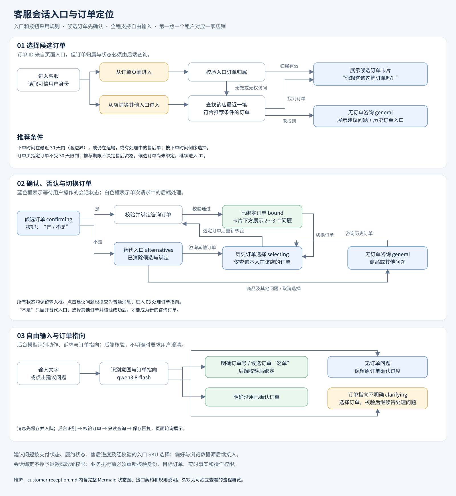
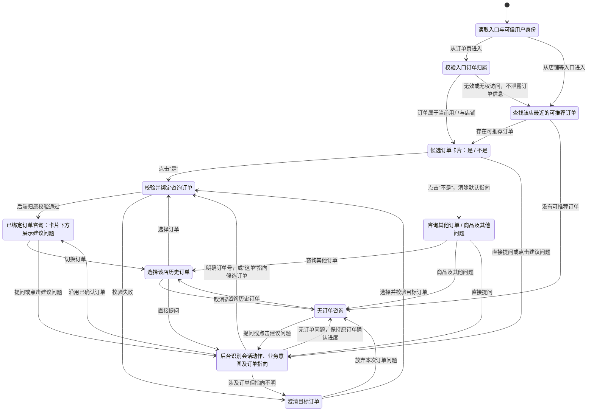

# 客服会话入口与订单定位

本页是后续实现和讨论的依据。入口推荐、按钮和建议问题使用普通后端规则；自由输入由 `qwen3.8-flash` 辅助理解，后端核验并执行状态变化。
第一版将一个租户视为一家店铺；增加多店铺能力时需要独立店铺归属和迁移。

## 流程图



[单独打开 SVG](customer-reception.svg)。SVG 用于直接查看和复用；下方 Mermaid 保留完整状态转移，
修改规则时同步维护两者。SVG 中分区衔接以文字说明，避免把所有回路交叉画在一起。

### Mermaid 状态图源码



`Bind` 是后端校验步骤；`Resolve` 在独立后台 Worker 中执行。消息先保存和入队，再调用模型。持久化状态为
`confirming / alternatives / selecting / general / bound / clarifying`。
无订单问题不会清除已展示的候选订单；已确认订单会保持，直到主动切换或出现歧义。
自由输入后台处理完成后以持久化上下文渲染页面，不会强制跳转到另一个咨询模式。

## 已确定规则

- 从订单页进入，优先推荐该订单，即使已超过 30 天。订单 ID 只是线索，必须查询归属。
- 其他入口选择下单时间最近的合格订单：30 天内，或仍在运输，或有 `open` 售后单。
  恰好 30 天计入；未来下单时间不计入。运输包括订单 `shipped`，以及包裹
  `shipped / in_transit / exception`。这是入口推荐规则，不是售后资格规则。
- 候选订单只负责展示；点击“是”、选择订单、输入明确订单号或指向候选的“这单”后才绑定。
- 点击“不是”清空候选和绑定，显示“咨询其他订单”“商品及其他问题”。历史订单列表不限 30 天。
- 全程接受自由输入。明确出现“订单号：XXX”时后端核验；否定、其他订单指向、多订单提及及
  无法识别的订单指向均先澄清。模型输出必须通过严格结构校验；模型不授予操作权限。
- 建议问题由模板按支付、履约、售后状态和经校验的入口 SKU 选择。尚无偏好或浏览数据源，
  不伪造个性化；未来通过可信数据源补充。建议表达咨询诉求，不承诺退款或改址资格。
- 一轮只保留最新待定位问题；新问题使旧待定位问题成为 `superseded`，内容仍保留。
  选定订单后自动将最新待定位问题关联该单。进入无订单咨询会放弃旧待定位问题。
- 所有状态更新使用行锁和客户端 `expected_version`，过期请求返回 409，前端刷新后重试。
  消息以客户端生成的 `message_id` 去重；同键不同文本拒绝。重复发送返回当前会话视图。
  前端在发送结果不明时保留该 ID 并先重试确认，再允许切换订单或发送其他问题。
- 会话、消息、状态审计及待处理消息 Outbox 同事务提交。Outbox 仅供后续 Agent 消费，
  独立 Worker 识别意图、调用只读工具并保存回复；不包含资金操作。用户文本不写入审计和 Outbox，仅存消息表。
  后续消费者必须读取消息自身的 `order_id`，不能用可能已切换的会话订单替代。

## 接口和前端使用

前缀 `/api/v1/supervisor/reception`。页面根据响应的 `prompt`、`candidate_order`、
`bound_order`、`buttons`、`suggestions` 渲染卡片和快捷问题；始终展示输入框。
已提供 Vue 3 + TypeScript 页面 `/customer-service`；开发和构建方式见 [前端指南](../frontend.md)。
从订单页跳转示例：`/customer-service?entry_point=order&order_id=<订单 UUID>`；
从店铺进入使用 `/customer-service?entry_point=store`，可附加 `sku_id=<商品 SKU UUID>`。
参数只是入口线索，不代表身份或订单访问权限。页面与 API 同源，通过已验证的登录会话使用。

### 选定订单后的建议问题

- 点击“是”或选择历史订单成功后，立即在订单卡片下方展示 2～3 个建议问题按钮。
- 后端按当前订单的支付、履约及售后状态生成 `suggestions`；切换订单时页面整组替换，
  不保留上一笔订单的问题。点击建议与手动输入都走消息接口，不直接执行业务操作。
- 输入框在所有阶段保持可见；网络请求期间暂时防止重复提交，但用户可继续编辑文字。
- 页面从上到下依次是：提示语、订单卡片、建议问题、确认或切换按钮、必要时的历史订单列表、
  咨询记录与自由输入框。记录从数据库加载，支持查询更早消息及刷新恢复会话。
- 待付款显示付款/优惠券问题，未发货显示发货/改址问题，出库处理中显示出库进度/能否改址，
  运输中显示物流/滞留问题，签收后显示破损/退换货问题；有在处理的售后单时优先显示售后进度。
- 接收后显示排队/处理进度；后台完成后展示保存的客服回复。未启动 Worker 时保持排队。

页面源文件位于 `frontend/src/`，按页面、组件、会话逻辑和 API 客户端拆分。
开发时由 Vite 提供页面并代理 API；部署时由 FastAPI 提供构建产物，业务判断仍由后端完成。

| 方法与路径 | 用途 |
| --- | --- |
| `POST /sessions` | 创建会话；`entry_point` 为 `order / store / other`，可传入口 `order_id`、`sku_id` |
| `GET /sessions/{id}` | 恢复会话和读取当前视图 |
| `POST /sessions/{id}/actions` | 提交按钮动作和 `expected_version` |
| `GET /sessions/{id}/orders?limit=20&offset=0` | 分页查询本人该店订单；仅 `selecting / clarifying` 状态允许 |
| `POST /sessions/{id}/messages` | 提交 `message_id`、`text` 和 `expected_version`；建议问题也走此接口 |

按钮动作：`confirm / deny / other_orders / general / select_order`。
`select_order` 必须传 `order_id`。响应 `version` 用作下一次写请求的 `expected_version`。
`latest_message.status` 为 `queued / processing / needs_order / ready_for_agent / completed / failed / superseded`。
`ready_for_agent` 表示选单后的原问题等待继续处理，`completed` 表示回复已保存。
`GET /sessions/{id}/messages?limit=50&before=<message_id>` 返回本人会话消息、回复及 `next_before`。
处理期间服务端拒绝同会话新消息和按钮操作（409），以免推理期间更换订单。

```json
{"entry_point": "order", "order_id": "<订单 UUID>"}
```

```json
{"action": "confirm", "expected_version": 1}
```

```json
{"message_id": "<客户端生成 UUID>", "text": "这单什么时候到？", "expected_version": 2}
```

### 身份接入与运行

认证中间件必须在验证登录凭据和店铺访问范围后，把 `CustomerIdentity(tenant_id, user_id)`
放入 `request.state.customer_identity`。定义见 `api/customer.py`；浏览器请求体和自报的 HTTP
用户 ID 头均不能作为身份来源。未接认证时接口返回 401，不提供默认身份或匿名订单查询。
业务服务还会检查用户是否有效；查询同时限定租户、用户、会话归属。

迁移执行 `alembic upgrade head`（新增迁移仅编写，未在本次运行）；另启 `python -m nexusguard.modules.supervisor.agent_worker`，详情见 [客服 Agent](../customer-agent.md)。
当前已提供聊天接待页面，但尚未接登录系统，因此需要宿主认证适配后使用。规则参数
`NEXUSGUARD_RECEPTION_RECENT_ORDER_DAYS` 默认 30，可在 `.env` 配置。
退款、改址等写操作以后必须独立核验身份、目标订单、最新事实与操作权限；会话绑定不授予权限。
